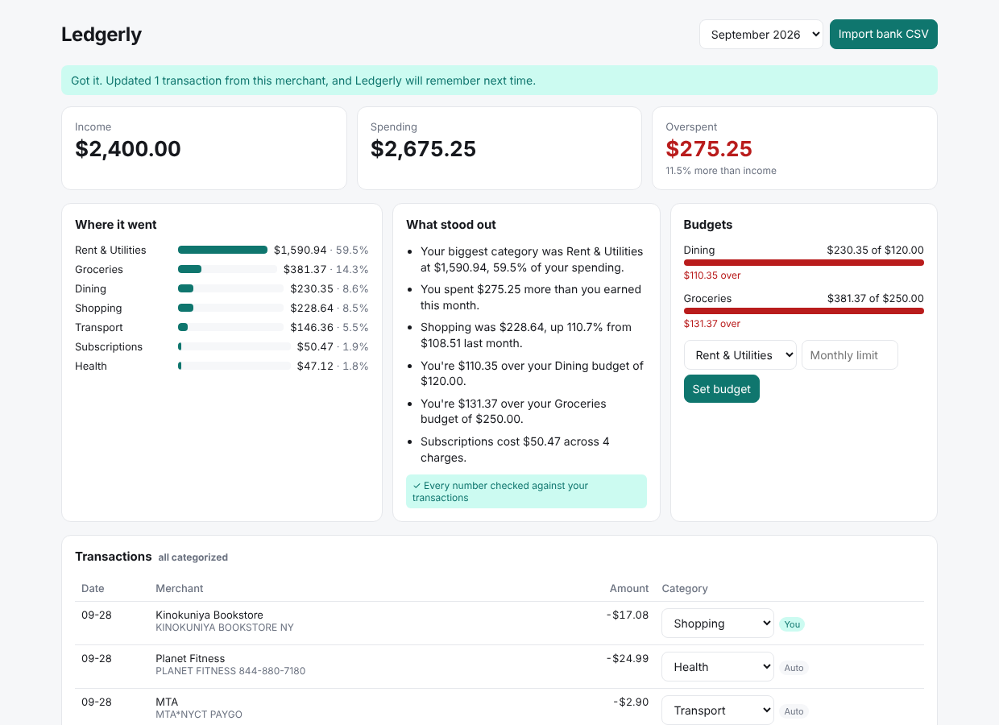

# Ledgerly

[](https://github.com/saundaryaverma/ledgerly/actions/workflows/ci.yml)

A personal finance app that imports your bank CSV, sorts every transaction into a category, and tells you in plain English where your money went. It never shows you an AI-written number it hasn't checked against your actual transactions.



**Stack:** React + TypeScript (Vite) · Python + FastAPI · PostgreSQL (SQLAlchemy 2) · optional LLM through any OpenAI-compatible API, including NVIDIA NIM

## What it does

- **Imports messy bank exports.** It handles a signed Amount column or separate Debit and Credit columns, dollar signs, commas, accounting-style `(12.00)`, and four date formats. Re-importing the same file skips duplicates, but two identical $2.90 subway rides on the same day are both kept. A bad row returns an error that names the row number.
- **Cleans merchant names.** `SQ *BLUE BOTTLE COFFEE 8823 NY` becomes **Blue Bottle Coffee**, and `AMAZON MKTPL*2K4L19 AMZN.COM/BILL WA` becomes **Amazon**.
- **Categorizes in three layers:**
  1. merchants you've corrected before (you fix a category once, and Ledgerly applies it to that merchant's other transactions and every future import)
  2. built-in rules for common merchants
  3. optionally, an LLM for whatever's left. Its answer has to be exactly one of the app's categories, or it's ignored and the transaction is marked **Needs review**. A model can't invent a category.
- **Shows the month at a glance:** income, spending, savings rate, spending by category, budgets with over-budget warnings, and a transaction list where you can fix categories inline.
- **Explains your spending, with every number checked.** Insights like *"Dining was $230.35, down 29.6% from $327.13 last month"* are written from computed numbers. If an LLM rewrites them to sound friendlier, a verifier checks that every dollar amount and percentage in the rewrite matches a number Ledgerly computed. If even one doesn't match, the rewrite is thrown away and the plain version is shown. Transfers between your own accounts don't count as income or spending.

## Why the verifier matters

Language models are good at sounding sure about numbers. In a finance app, "you spent $310 on dining" when the real figure is $300 is worse than no insight at all. So Ledgerly treats the model as a writer, not a calculator: the math happens in SQL and Python, and the model only gets to rephrase it. `verify_numbers()` in `backend/app/analytics.py` is the gate, and tests cover both paths: a rewrite with correct numbers is kept, and one with an invented number is discarded.

## Run it

**With Docker (PostgreSQL included):**

```bash
docker compose up --build
# open http://localhost:5173 and import backend/sample_data/transactions.csv
```

**Without Docker** (the backend falls back to a local SQLite file if `DATABASE_URL` isn't set):

```bash
cd backend && pip install -r requirements-dev.txt
uvicorn app.main:app --reload            # http://localhost:8000/docs for the API

cd frontend && npm install && npm run dev  # http://localhost:5173
```

**Optional AI:** set `LLM_API_KEY`. For NVIDIA NIM, also set `LLM_BASE_URL=https://integrate.api.nvidia.com/v1` and `LLM_MODEL=meta/llama-3.1-8b-instruct`. Without a key, everything works: the AI layers are simply skipped.

## API

| Method | Path | What it does |
|---|---|---|
| POST | `/api/import` | Upload a bank CSV |
| GET | `/api/months` | Months that have data |
| GET | `/api/transactions?month=2026-09` | A month's transactions |
| PATCH | `/api/transactions/{id}` | Fix a category; Ledgerly learns the merchant |
| PUT | `/api/budgets/{category}` | Set a monthly budget |
| GET | `/api/summary?month=2026-09` | Totals, categories, budgets, and verified insights |

## Tests

```bash
cd backend && pytest                       # 31 tests
TEST_DATABASE_URL=postgresql+psycopg2://... pytest   # same tests on PostgreSQL
cd frontend && npm test                    # 6 tests
```

The backend tests cover CSV parsing edge cases, merchant cleaning, every categorization layer (including a model answering with a made-up category, or throwing an error), the insight verifier, budgets, and the full API: import, re-import, corrections that teach the merchant, and validation errors. CI runs the backend suite on both SQLite and PostgreSQL 16, then the frontend tests and production build.

## Performance

`backend/scripts/benchmark.py` imports a synthetic 10,000-transaction CSV and then times the monthly summary endpoint. On a development container with a local PostgreSQL 16 server:

- **10,000 transactions imported and categorized in 1.75 seconds**
- **Monthly summary: 12 ms median, 16 ms p95** (50 requests)

Run it on your own machine with `python scripts/benchmark.py --url http://localhost:8000`.

## Sample data

`backend/sample_data/transactions.csv` holds three months of invented transactions for a New York graduate student, in the messy descriptor format banks really use. It's generated by `sample_data/generate.py` from a fixed seed.

## What I'd build next

- Recurring-charge detection, to flag subscriptions you forgot about
- Bank sync through an aggregator API instead of CSV upload
- Splitting one transaction across categories
- An evaluation set of labeled descriptors, to measure categorization accuracy for each layer

MIT licensed.
